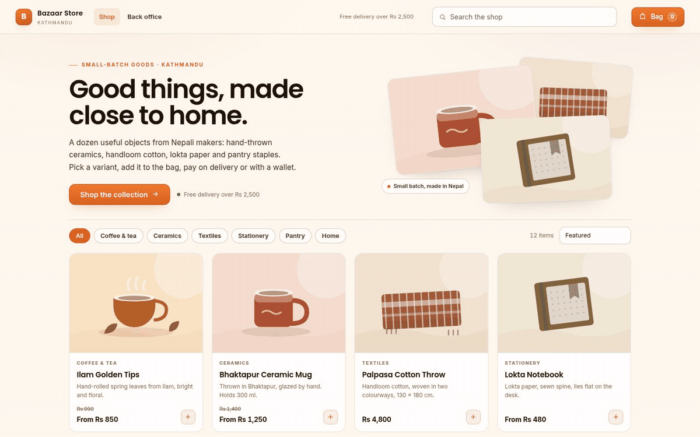
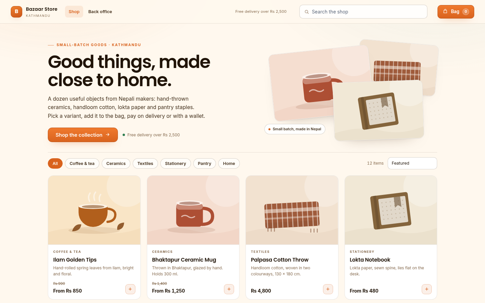
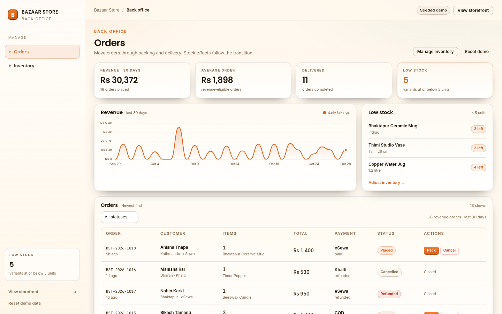

<div align="center">

</div>

<sub>Recorded from the live demo, <a href="docs/demo.mp4">MP4</a> · <a href="docs/screenshot.png">static frame</a></sub>

# Bazaar Store

A small-shop commerce demo with two sides: a storefront where you can pick
variants, build a bag and check out with cash on delivery, eSewa or Khalti, and a
back office where those orders move through packing, shipping, delivery,
cancellation and refunds while the stock counts follow along. No dependencies,
no build step, no network calls after the page loads.

[**Open the live demo**](https://arvion-technology.github.io/labs/demos/storefront/) · [CI](https://github.com/arvion-technology/storefront/actions/workflows/ci.yml) · [MIT](LICENSE)

---

Commerce demos often stop at a product grid and a fake checkout. The part that
makes a shop work is below that: what the cart costs after a promo is split
across lines, which units are still available when two people check out at once,
and what happens to the stock when an order is cancelled a day later. This
project puts those rules in `src/`, tests them, and then renders both ends of
the shop from the same state.

The catalogue, the stock counts and a month of orders are seeded locally. Every
price is in paisa as an integer; the storefront and the back office read the
same values.

## What it does

- **Storefront**: 12 products across six categories, search, category filters
  and sorting. Each product has two or three variants with their own price and
  stock, and the product page shows live availability.
- **Bag drawer**: quantity rules, sale savings, promo codes, a free-delivery
  meter and a checkout that re-prices the cart whenever it changes.
- **Checkout**: contact and delivery details, then cash on delivery, eSewa or
  Khalti. The wallet adapters are local mocks: a short fake redirect returns a
  reference code and no money moves.
- **Order confirmation**: order number, payment state, the timeline so far and
  the receipt, with a link into the back office.
- **Back office orders**: revenue and average-order tiles, a 30-day revenue
  chart, low-stock alerts and an order table. Placed orders can be packed,
  shipped, delivered, cancelled or refunded; stock effects are part of the
  transition, not a follow-up job.
- **Inventory**: on-hand and reserved units per variant, with adjustments for
  one unit or five. On-hand cannot be cut below what open orders have reserved.
- Local persistence for the cart, inventory and orders, plus a reset button that
  rebuilds the seeded shop.

## Screenshots

| Storefront | Back office |
| --- | --- |
|  |  |

## Architecture

```text
browser
├── demo/
│   ├── index.html      citrus-theme shell
│   ├── app.js          routing, storefront views, back-office views, events
│   ├── art.js          inline SVG product illustrations (no image files)
│   ├── seed.js         opening stock and a month of orders
│   ├── styles.css      commerce components on top of arvion.css
│   └── arvion.css/.js  shared Arvion design system (not edited)
│
├── src/
│   ├── catalog.js      products, variants, filtering, sorting, search
│   ├── money.js        paisa arithmetic and Rs formatting
│   ├── promos.js       promo rules and validation reasons
│   ├── cart.js         quantity caps, pricing, discount allocation, shipping
│   ├── inventory.js    reservation, release, commit, restock, adjustments
│   ├── orders.js       payment adapters and the order state machine
│   └── revenue.js      dense daily revenue, averages, payment split
│
└── test/               48 node:test cases
```

The demo imports `../src/*.js` directly. The back office and the storefront do
not have separate stock logic; they call the same functions.

**Data model.** A product holds variants, and stock is tracked per variant key:

```js
{
  id: "ceramic-mug",
  name: "Bhaktapur Ceramic Mug",
  variants: [
    { id: "rust", label: "Rust", price: 125000, compareAt: 140000, stock: 14 },
    { id: "indigo", label: "Indigo", price: 135000, stock: 3 }
  ]
}

// inventory entry, keyed "ceramic-mug:rust"
{ onHand: 14, reserved: 0 }   // available = onHand - reserved
```

Prices are integers in paisa, so 10% off Rs 2,500 is exactly Rs 250 before it is
shown as money.

## Quickstart

```bash
git clone https://github.com/arvion-technology/storefront.git
cd storefront
npm test          # 48 tests, Node 20 or newer, nothing to install
npm run demo      # http://localhost:4173
```

`package.json` exists for `npm test` and CI; there are no runtime dependencies.
To recapture the screenshots:

```bash
npm run shot
npm run shot:2
```

## How it works

**Pricing is one function with line-level discounts.** `priceCart(cart, catalog,
{ promoCode })` resolves each line's sale price, computes the promo discount
against the current subtotal, then allocates that discount across the lines by
value with the paisa remainders handed out to the largest fractions. The shares
always add up to the discount exactly, so the cart, the checkout summary and the
receipt cannot disagree by one rupee. Shipping is flat Rs 150 and free from
Rs 2,500; a shipping promo sets it to zero.

```js
const priced = priceCart(cart, CATALOG, { promoCode: "NEW10" });
// {
//   subtotal: 250000, saleDiscount: 30000, promoDiscount: 25000,
//   shipping: 0, total: 225000,
//   lines: [{ subtotal: 250000, total: 225000, ... }]
// }
```

Promo validation is separate from pricing and re-runs on every price call, so a
cart that drops below the minimum stops applying the code instead of carrying a
stale discount. Percent discounts round to the nearest rupee; the seeded shop
has no paisa in its shelf prices.

**Stock is reserved, committed, released or restocked, depending on where the
order is.** `reserve` checks every line first and only then increments
`reserved`, so a two-line checkout cannot half-succeed.

```js
// one unit left, two checkouts
reserve(inventory, [{ key: "home-jug:1.2l", qty: 1 }]); // { ok: true }
reserve(inventory, [{ key: "home-jug:1.2l", qty: 1 }]); // { ok: false, available: 0 }
```

The state machine is small and explicit:

| From | Allowed |
| --- | --- |
| placed | packed, cancelled |
| packed | shipped, cancelled |
| shipped | delivered, refunded |
| delivered | refunded |
| cancelled / refunded |: |

Shipping commits the reservation (`onHand -= qty`), cancelling releases it,
and refunding restocks it. Because the stock effect lives in `transitionOrder`,
the back office cannot mark an order cancelled and forget to give the units
back.

**Revenue is a policy, not an accident.** The 30-day chart uses dense UTC day
buckets, so quiet days appear as zero. An order counts toward revenue from the
moment it is placed until it is cancelled or refunded; refunds are not netted
against a later day, they simply stop the order counting. The back office shows
the resulting revenue, average order and payment split; the tests pin the
policy down with fixed timestamps.

**Back-office actions are the same functions as the tests.** A packed order is
`transitionOrder(order, "packed", inventory)`. An inventory adjustment is
`adjust(inventory, key, delta)`, which refuses to take on-hand below reserved
units and returns the maximum safe decrease when it says no.

## Tests

```bash
npm test
```

48 tests on `node:test` cover catalogue search and sorting, cart quantity caps,
sale pricing, shipping thresholds, exact discount allocation, promo validation
and caps, all-or-nothing stock reservation (including the last-unit race),
release/commit/restock paths, inventory adjustment limits, every legal and
illegal order transition, refund and cancellation stock effects, order numbering,
payment mock references, dense revenue buckets, revenue exclusions, averages,
payment splits and top products.

The demo also has a static check for asset references, theme wiring and
placeholder text:

```bash
node scripts/serve-check.mjs
```

## Limitations

There is no server. Stock, orders and the cart live in one browser's
localStorage, so the "two checkouts for the last unit" case is tested as two
sequential reservations, not as real concurrency. A production version would
move reservation into a database transaction or a short-lived lock and treat the
client as a cache. The payment adapters are mocks by design: eSewa and Khalti
never leave the page, and the seeded customer names and addresses are sample
data.

The catalogue is also intentionally small. A real shop needs product editing,
image uploads, tax rules per province, partial refunds and a courier
integration; none of that is pretended here.

## Project layout

```text
storefront/
├── demo/               # static two-sided app (no build step)
│   ├── index.html
│   ├── app.js          # routing, storefront and back-office views
│   ├── art.js          # inline SVG product art
│   ├── seed.js         # opening stock and a month of orders
│   ├── styles.css      # citrus-theme commerce components
│   ├── arvion.css/.js  # shared design system
│   └── fonts/          # self-hosted Inter + Poppins
├── src/
│   ├── catalog.js      # products, variants, search, sort
│   ├── money.js        # paisa formatting
│   ├── promos.js       # promo data and validation
│   ├── cart.js         # pricing, quantity rules, allocation
│   ├── inventory.js    # reservations and adjustments
│   ├── orders.js       # checkout, payments, state machine
│   └── revenue.js      # daily revenue aggregation
├── test/               # 48 node:test cases
├── scripts/            # serve, screenshot, static checks
└── .github/workflows/  # CI: tests on Node 20 and 22
```

## Credits

Built by [Arvion Technologies](https://arviontech.net) in Kathmandu as part of
the [Arvion Labs](https://github.com/arvion-technology/labs) open-source series.
MIT licensed.
